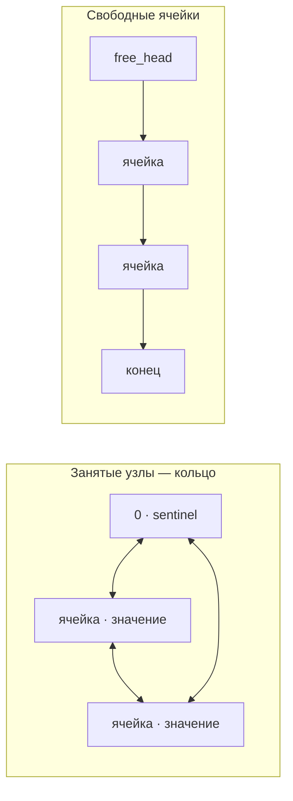

# eduLinkedList

**Двусвязный список на C, у которого можно заглянуть под капот.** Узлы хранятся в массиве, связи задаются индексами, а отдельный список свободных ячеек помогает понять, что происходит с памятью при вставке и удалении.

Проект учебный: `list.c` запускает демонстрацию, а после операций сохраняет снимки структуры в HTML и SVG.

## Что внутри

- **Индексные узлы:** `prev` и `next` содержат индексы ячеек массива, а не указатели.
- **Фиктивный узел:** ячейка `0` служит sentinel-узлом и замыкает цепочку занятых элементов.
- **Free-list:** свободные ячейки связаны отдельно и повторно используются при вставке.
- **Изменение размера:** массив расширяется при нехватке места и может уменьшаться после удалений.
- **Проверка структуры:** `verify_list` проверяет базовые инварианты списка и свободных ячеек.
- **Наглядные дампы:** программа пишет текстовое представление, DOT-граф и SVG-схему для каждого снимка.



## Быстрый старт

Нужны компилятор C (`clang` или `gcc`) и [Graphviz](https://graphviz.org/) — команда `dot` используется для построения SVG.

Установить Graphviz можно, например, так:

```sh
# macOS, если установлен Homebrew
brew install graphviz

# Debian / Ubuntu
sudo apt install graphviz
```

Соберите и запустите демонстрацию из каталога проекта:

```sh
cc list.c -o linked-list
./linked-list
```

После запуска откройте `dump.html` в браузере. Например:

```sh
# macOS
open dump.html

# Linux
xdg-open dump.html
```

Программа создаёт `dump.html`, файлы `dump<N>.dot` и соответствующие `dump_<N>.svg` в текущем каталоге. Повторный запуск начинает нумерацию снимков заново и перезаписывает файлы с теми же именами.

## Как устроен API

| Функция | Назначение |
| --- | --- |
| `list_constructor(&list, n)` | Создаёт список с начальным массивом на `n` ячеек. |
| `insert_before(&list, value, pos)` | Вставляет значение перед узлом с внутренним индексом `pos`. Индекс `0` — sentinel. |
| `remove_node(&list, pos)` | Удаляет узел по внутреннему индексу и возвращает ячейку в free-list. |
| `verify_list(&list)` | Проверяет связи занятых узлов и цепочку свободных ячеек. |
| `list_dump(&list, file, label)` | Добавляет HTML-снимок и строит SVG-граф. |
| `list_deconstructor(&list)` | Освобождает память массива списка. |

`pos` — это **индекс ячейки в массиве**, а не порядковый номер элемента при обходе списка. Например, чтобы вставить перед первым реальным узлом, сначала нужно прочитать индекс этого узла из `list.data[0].next`.

## Демонстрация

Последовательность операций задаётся в `main` в [list.c](list.c). Там же можно менять начальный размер, значения и точки, в которых сохраняются дампы. Реализация списка и визуализатора находится в [link.h](link.h), стили страницы — в [dump.css](dump.css).

В HTML-отчёте для каждого шага показаны:

- таблица `INDX / VALU / PREV / NEXT` по всем ячейкам массива;
- текущий размер массива и значение счётчика `capacity`;
- подпись операции;
- схема занятых узлов и free-list.

## Структура проекта

```text
.
├── list.c      # демонстрационный сценарий
├── link.h      # список, проверки и генератор дампов
├── colors.h    # ANSI-цвета для сообщений в терминале
├── dump.css    # оформление HTML-отчёта
└── dump.html   # HTML-отчёт, перезаписывается при запуске
```
